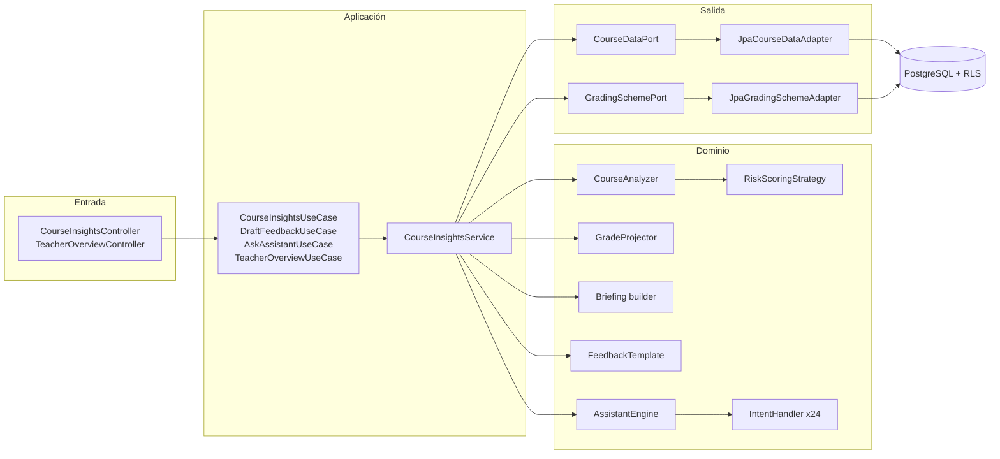

# Módulo `insights`: arquitectura

El asistente docente (análisis del curso, simulador de notas, mensajes y el Búho) está construido con **puertos y adaptadores**.

## Patrones

| Patrón | Dónde | Por qué |
|---|---|---|
| Strategy | `RiskScoringStrategy` (`TrendWeightedRiskStrategy`, `GradeOnlyRiskStrategy`) | La fórmula del riesgo se elige por configuración (`fairteam.insights.risk`) sin tocar el analizador. |
| Chain of Responsibility | `AssistantEngine` + `IntentHandler` | Cada habilidad del Búho es una clase; el orden de la cadena decide la prioridad. |
| Template Method | `FeedbackTemplate` (`WarmFeedback`, `FormalFeedback`, `EncouragingFeedback`) | La estructura del mensaje es fija; cada tono cambia saludo y despedida. |
| Factory Method | `FeedbackTemplate.forTone` | El cliente pide un tono, no una clase concreta. |
| Builder | `Briefing` | El resumen se arma paso a paso y solo agrega frases con algo que decir. |
| Ports & Adapters | `application.port.in/out`, `adapter.in/out` | El dominio y el servicio no dependen de Spring ni de JPA y se prueban con puertos en memoria. |

## Cómo agregar una habilidad al Búho

1. Crea `MiIntencionHandler implements IntentHandler` en `insights.domain.assistant`.
2. Devuelve `Optional.empty()` si la pregunta no es para ti.
3. Regístralo en `AssistantEngine.standard()` en el lugar de la cadena que le corresponda.
4. Agrega `MiIntencionHandlerTest` usando `AssistantFixture`.
