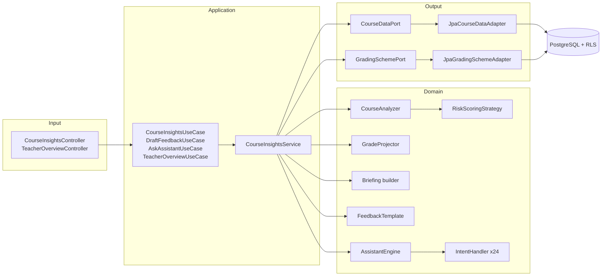

# `insights` module: architecture

The teacher assistant (course analysis, grade simulator, messages and Búho) is built with **ports and adapters**.

## Patterns

| Pattern | Where | Why |
|---|---|---|
| Strategy | `RiskScoringStrategy` (`TrendWeightedRiskStrategy`, `GradeOnlyRiskStrategy`) | The risk formula is chosen by configuration (`fairteam.insights.risk`) without touching the analyzer. |
| Chain of Responsibility | `AssistantEngine` + `IntentHandler` | Each Búho skill is a class; the order of the chain decides priority. |
| Template Method | `FeedbackTemplate` (`WarmFeedback`, `FormalFeedback`, `EncouragingFeedback`) | The message structure is fixed; each tone changes the greeting and the closing. |
| Factory Method | `FeedbackTemplate.forTone` | The client asks for a tone, not for a concrete class. |
| Builder | `Briefing` | The summary is assembled step by step and only adds sentences that have something to say. |
| Ports & Adapters | `application.port.in/out`, `adapter.in/out` | The domain and the service do not depend on Spring or JPA and are tested with in-memory ports. |

## How to add a skill to Búho

1. Create `MyIntentHandler implements IntentHandler` in `insights.domain.assistant`.
2. Return `Optional.empty()` if the question is not for you.
3. Register it in `AssistantEngine.standard()` at the right place in the chain.
4. Add `MyIntentHandlerTest` using `AssistantFixture`.
