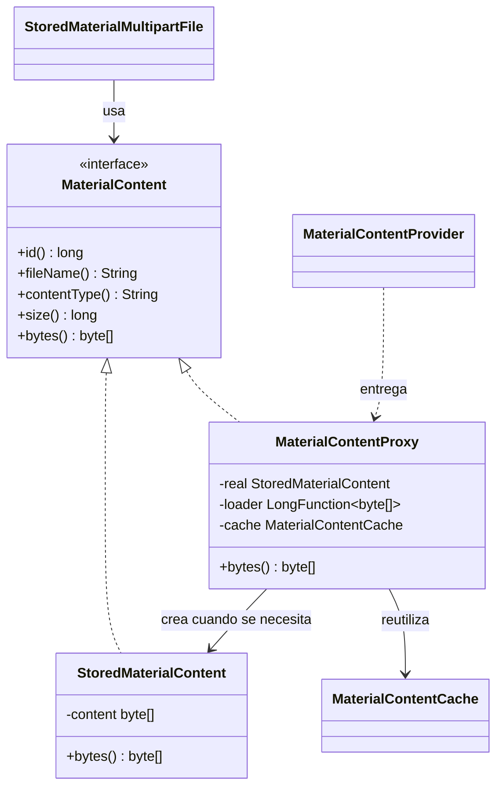

# Patrón Proxy: material de clase

El Proxy es un patrón **estructural** que pone un intermediario entre el cliente y un objeto para
controlar el acceso a él. En FairTeam lo usamos con el material de clase (PDF, DOCX o TXT de hasta
10 MB) que el docente sube para generar talleres con IA.

## El problema

Antes, cada vez que el backend necesitaba un material cargaba la entidad completa, con el archivo:

- para **borrarlo** leía hasta 10 MB que nunca usaba;
- al **generar un taller** con seis materiales leía hasta 60 MB *antes* de validar el nivel o el tema,
  aunque la solicitud terminara rechazada;
- generar varios talleres seguidos con el mismo PDF lo leía de PostgreSQL **cada vez**.

## La solución, igual que en la clase

| Clase (red social) | FairTeam | Rol |
| --- | --- | --- |
| `SocialMediaProfile` | `material/MaterialContent` | Sujeto: interfaz común |
| `RealProfile` | `material/StoredMaterialContent` | Sujeto real: el archivo ya leído |
| `ProfileProxy` | `material/MaterialContentProxy` | Proxy: controla el acceso |



```java
// ProfileProxy de la clase                         // MaterialContentProxy en FairTeam
public void viewProfile() {                         public synchronized byte[] bytes() {
    if (realProfile == null) {                          if (real == null) {
        realProfile = new RealProfile(username);            real = cache.get(id).orElseGet(() -> /* lee de BD */);
    }                                                   }
    realProfile.viewProfile();                          return real.bytes();
}                                                   }
```

## Las tres ventajas vistas en clase

- **Carga diferida (lazy loading):** el proxy se crea solo con los metadatos (nombre, tipo, tamaño).
  El archivo se lee la primera vez que alguien llama a `bytes()`. Por eso `StoredMaterialMultipartFile`
  responde nombre, tamaño y `isEmpty()` sin tocar el archivo, y la validación rechaza una solicitud
  inválida antes de leer ningún PDF.
- **Control de acceso:** `MaterialContentProvider.forCourse(courseId, materialId)` solo entrega un proxy
  si la consulta de metadatos encuentra el material en ese curso. Esa consulta pasa por la seguridad
  por filas de PostgreSQL, así que un docente nunca obtiene el material de otro (responde 404).
- **Caché:** los archivos leídos quedan en `MaterialContentCache`, un LRU limitado por bytes (40 MB por
  defecto, `fairteam.materials.cache-bytes`). El control de acceso se hace siempre antes de usar la caché,
  y borrar un material lo saca de ella.

## Desventajas, y cómo se tienen en cuenta

- **Más complejidad:** son cuatro clases pequeñas en un solo paquete (`material/`) y el resto del
  backend solo conoce la interfaz `MaterialContent`.
- **Sobrecarga:** la consulta de metadatos se hace siempre; es una fila sin el archivo, mucho más barata
  que la lectura que evita.
- **Diseño adicional:** el repositorio separa `findMetadataByIdAndCourseId` (barata) de
  `findContentByIdAndCourseId` (solo el archivo), para que el proxy pueda pedir cada cosa por separado.

## Pruebas

`MaterialContentProxyTest`, `MaterialContentCacheTest`, `MaterialContentProviderTest` y
`StoredMaterialMultipartFileTest` comprueban que los metadatos no cargan el archivo, que se lee una sola
vez, que la caché se comparte entre proxies y respeta su límite, y que un material de otro curso da 404.
