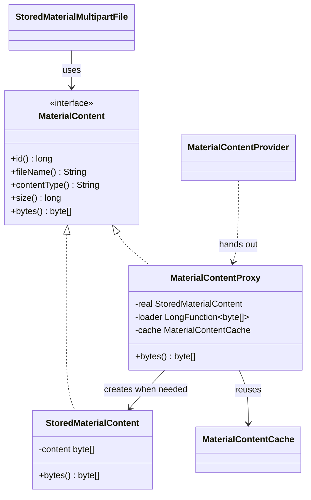

# Proxy pattern: class material

Proxy is a **structural** pattern that puts an intermediary between the client and an object to
control access to it. In FairTeam we use it for class material (PDF, DOCX or TXT up to
10 MB) that the teacher uploads to generate workshops with AI.

## The problem

Before, every time the backend needed a material it loaded the whole entity, including the file:

- to **delete** it, it read up to 10 MB it never used;
- when **generating a workshop** with six materials it read up to 60 MB *before* validating the level or topic,
  even if the request ended up rejected;
- generating several workshops in a row with the same PDF read it from PostgreSQL **every time**.

## The solution, as in class

| Class (social network) | FairTeam | Role |
| --- | --- | --- |
| `SocialMediaProfile` | `material/MaterialContent` | Subject: common interface |
| `RealProfile` | `material/StoredMaterialContent` | Real subject: the file already read |
| `ProfileProxy` | `material/MaterialContentProxy` | Proxy: controls access |



```java
// ProfileProxy from class                          // MaterialContentProxy in FairTeam
public void viewProfile() {                         public synchronized byte[] bytes() {
    if (realProfile == null) {                          if (real == null) {
        realProfile = new RealProfile(username);            real = cache.get(id).orElseGet(() -> /* read from DB */);
    }                                                   }
    realProfile.viewProfile();                          return real.bytes();
}                                                   }
```

## The three advantages seen in class

- **Lazy loading:** the proxy is created with metadata only (name, type, size).
  The file is read the first time someone calls `bytes()`. That is why `StoredMaterialMultipartFile`
  answers name, size and `isEmpty()` without touching the file, and validation rejects an
  invalid request before reading any PDF.
- **Access control:** `MaterialContentProvider.forCourse(courseId, materialId)` only hands out a proxy
  if the metadata query finds the material in that course. That query goes through PostgreSQL's
  row-level security, so a teacher never gets another teacher's material (it answers 404).
- **Cache:** files that were read stay in `MaterialContentCache`, an LRU bounded by bytes (40 MB by
  default, `fairteam.materials.cache-bytes`). Access control always happens before the cache is used,
  and deleting a material removes it from the cache.

## Disadvantages, and how they are handled

- **More complexity:** four small classes in a single package (`material/`) and the rest of the
  backend only knows the `MaterialContent` interface.
- **Overhead:** the metadata query always runs; it is one row without the file, much cheaper
  than the read it avoids.
- **Additional design:** the repository separates `findMetadataByIdAndCourseId` (cheap) from
  `findContentByIdAndCourseId` (the file only), so the proxy can ask for each one separately.

## Tests

`MaterialContentProxyTest`, `MaterialContentCacheTest`, `MaterialContentProviderTest` and
`StoredMaterialMultipartFileTest` check that metadata does not load the file, that it is read only
once, that the cache is shared between proxies and respects its limit, and that a material from another course gives 404.
